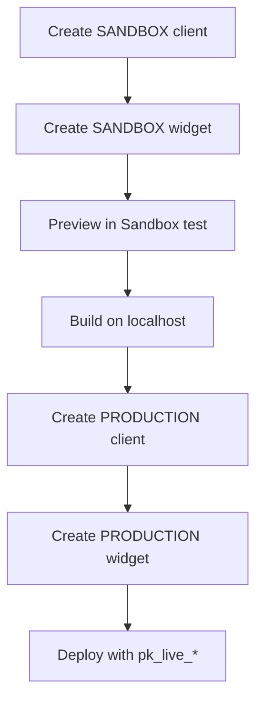

Every API client and review widget belongs to one environment. Match them deliberately.

## Production (`PRODUCTION`)

- Keys: `pk_live_*`, `sk_live_*`
- Data: real **ACTIVE** reviews for your organization
- Widget shows top-rated reviews (`minStars` default 4, sort `top`)
- Use on your public website after testing

## Sandbox (`SANDBOX`)

- Keys: `pk_test_*`, `sk_test_*`
- Data: **synthetic demo testimonials** — isolated from production
- Same API paths and response shape as production
- Use during development and CI without affecting live ratings
- Digital platform partner routes (`/partner/platform/...`) also return synthetic fixtures when the client is sandbox

<Check>
  Sandbox and production credentials are fully separate. Rotating or revoking one does not affect the other.
</Check>

## Environment match rule

| Publishable key | Widget environment | Result |
| --------------- | ------------------ | ------ |
| `pk_test_*` | **SANDBOX** | Synthetic reviews |
| `pk_live_*` | **PRODUCTION** | Live reviews |
| `pk_test_*` | **PRODUCTION** | `403` mismatch |
| `pk_live_*` | **SANDBOX** | `403` mismatch |

Documented again in [Sandbox overview](/sandbox/overview) and [Errors](/errors).

## Recommended workflow



## Dashboard checklist

| Step | Sandbox | Production |
| ---- | ------- | ---------- |
| API keys | `pk_test_*` + `sk_test_*` | `pk_live_*` + `sk_live_*` |
| Allowed origins | localhost, staging | production domain(s) |
| Review widgets | SANDBOX widget | PRODUCTION widget |
| Sandbox test | Preview + copy snippets | N/A (use live site) |
| Digital platform | Marketplace scopes on sandbox client | Live marketplace SSR + embeds |
| Telegram | Optional test group | Live customer group |

## Public API base URL

Both environments call:

```
https://api.ethioreview.com/api/v1
```

The key and widget environment decide which data you receive — there is no separate sandbox hostname for the public API.

[Quickstart →](/quickstart) · [Create sandbox keys →](/api-keys/create-sandbox) · [Digital platform sandbox →](/integrations/digital-platform/sandbox)
