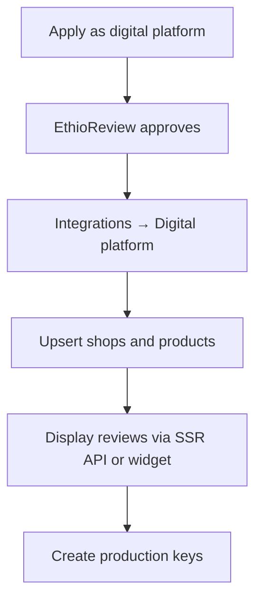

EthioReview supports **digital platform partners** such as multi-vendor ecommerce sites. After approval you provision vendor shops by API and display EthioReview ratings on your own pages.

## Who this is for

Marketplace operators (not single-business widgets). You need EthioReview approval as a digital platform before marketplace partner routes unlock.

## Three review layers

Ratings stay separate. Shop reviews do not change the platform score. Product reviews do not change the shop score.

| Layer | What customers rate | Typical page |
| ----- | ------------------- | ------------ |
| **Platform** | Your marketplace / app as a digital product | Homepage, about, trust badge |
| **Shop** | Each vendor storefront | Seller profile |
| **Product** | Each SKU or listing | Product detail |

## High-level flow

## Dashboard entry

All marketplace setup starts at **Integrations → Digital platform** in the [dashboard](https://app.ethioreview.com). You can also create scoped clients under **Integrations → API keys**.

## What you get after approval

- A marketplace organization on EthioReview
- A **platform digital product** customers can review
- API credentials with scopes `marketplace:shops` and `reviews:read`
- Ability to create unclaimed vendor shops your sellers can claim later

## One failure mode

**Calling partner platform routes with a normal `reviews:read` client** — you need `marketplace:shops` (created from **Digital platform** or an API key with that scope).

## Next steps

1. [Create sandbox keys](/integrations/digital-platform/sandbox)
2. [Provision shops and products](/integrations/digital-platform/provision-shops)
3. [Display reviews](/integrations/digital-platform/display-reviews)
4. [Dashboard checklist](/dashboard/digital-platform-setup)
