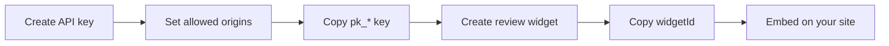

The **widget registry** stores layout configuration for each embed. You reference a widget by `widgetId`; the backend returns reviews, rating data, and dashboard settings in one call.

## Who this is for

Teams that want layout, min-stars, and limits managed in the dashboard instead of hard-coded in every site.

## Dashboard steps



### 1. Create an API key

**Integrations → API keys → Create**.

- Set **allowed origins** to every domain that will host the widget
- Copy the **publishable key** (`pk_live_*` or `pk_test_*`)
- Match environment to how you will test or ship

### 2. Create a review widget

**Integrations → Review widgets → Create**.

| Field | Purpose |
| ----- | ------- |
| **Name** | Internal label |
| **Type** | `BADGE`, `CAROUSEL`, `TESTIMONIAL`, `GRID`, or `LIST` — maps to a default layout |
| **Environment** | Must match your API client (**PRODUCTION** or **SANDBOX**) |
| **Min stars** | Lowest rating to include (default 4) |
| **Config** | Optional JSON — set `layout` to override the default (e.g. `"trust-score"`) |

Copy the **widget ID** from the widget detail page. Optionally preview under **Integrations → Sandbox test**.

### 3. Embed on your site

```tsx
import { ReviewWidget } from "@ethioreview/review-widget-react";
import "@ethioreview/review-widget-react/styles.css";

<ReviewWidget
  baseUrl="https://api.ethioreview.com"
  publicKey="pk_live_YOUR_KEY"
  widgetId="YOUR_WIDGET_ID"
/>
```

```html
<script async src="https://cdn.ethioreview.com/widget.js"></script>
<review-widget
  data-base-url="https://api.ethioreview.com"
  data-public-key="pk_live_YOUR_KEY"
  data-widget-id="YOUR_WIDGET_ID"
></review-widget>
```

## Resolve endpoint

`GET /api/v1/widgets/resolve/{widgetId}` returns widget metadata, paginated reviews, and `ratingSummary`.

Auth: `X-Widget-Key` header with your publishable key.

## Widget type → layout mapping

| Dashboard type | Default layout |
| -------------- | -------------- |
| `BADGE` | Micro badge |
| `TESTIMONIAL` | Review carousel |
| `CAROUSEL` | Review carousel |
| `GRID` | Review carousel |
| `LIST` | Default list |

Override with `config.layout` in the dashboard or the React `layout` prop.

## One failure mode

**Widget created in PRODUCTION but embed still uses `pk_test_*`** — resolve returns `403` environment mismatch. Create a sandbox widget for local work, or switch the embed to `pk_live_*`.

## Next

[React embed →](/integrations/widget/embed-react) · [Credentials →](/integrations/widget/credentials)
