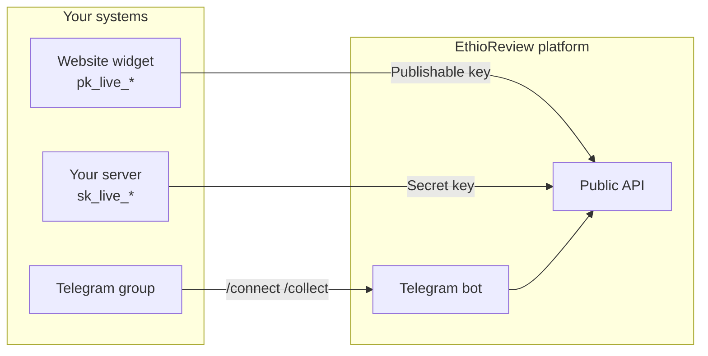

EthioReview provides **developer tools** for businesses and government organizations to:

- **Embed top-rated testimonials** on any website via the Review Widget
- **Connect a Telegram group** to collect reviews and receive new-review notifications
- **Fetch review data server-side** with API client credentials
- **Provision marketplace shops** if you operate a digital platform

<Note>
  This site is the **developer documentation portal**. Day-to-day setup happens in the [EthioReview dashboard](https://app.ethioreview.com) under **Integrations**. Use this portal for step-by-step guides and API reference.
</Note>

## Public endpoints

| Resource | URL |
| -------- | --- |
| API | `https://api.ethioreview.com/api/v1` |
| Dashboard | `https://app.ethioreview.com` |
| Docs | `https://docs.ethioreview.com` |

## What you will build

<CardGroup cols={2}>
  <Card title="Review widget" icon="code" href="/integrations/widget/overview">
    Show top-rated reviews with reviewer names on your site. Uses a publishable key in the browser.
  </Card>
  <Card title="API keys" icon="key" href="/api-keys/create-sandbox">
    Create sandbox (`pk_test_*`) and production (`pk_live_*`) credentials with allowed origins.
  </Card>
  <Card title="Sandbox" icon="flask" href="/sandbox/overview">
    Preview synthetic reviews in the dashboard, then embed them in a local sample app.
  </Card>
  <Card title="Telegram bot" icon="message" href="/integrations/telegram/overview">
    Link a Telegram group, collect reviews via `/collect`, and get notified when reviews publish.
  </Card>
</CardGroup>

## Architecture at a glance

<Note>
  Use **publishable keys** (`pk_*`) only in browser embeds. Keep **secret keys** (`sk_*`) on your server — never in client-side code or public repositories.
</Note>

## Dashboard map

Everything under **Integrations** in the business dashboard:

| Section | What you do |
| ------- | ----------- |
| **API keys** | Create SANDBOX (`pk_test_*`) or PRODUCTION (`pk_live_*`); secret shown once |
| **Review widgets** | Register layouts; link to a matching-environment API client |
| **Sandbox test** | Live preview + copy HTML / React / iframe snippets |
| **Digital platform** | Marketplace scopes, shop provisioning helpers |
| **Telegram** | Link codes, connection status, notifications |

## Recommended flow

<Steps>
  <Step title="Create sandbox keys">
    **Integrations → API keys** → environment **SANDBOX**.
    [Create sandbox keys →](/api-keys/create-sandbox)
  </Step>
  <Step title="Register a sandbox widget">
    **Integrations → Review widgets** → environment **SANDBOX**, linked to that client.
  </Step>
  <Step title="Preview and copy snippets">
    **Integrations → Sandbox test**, then try a [sample app](/sandbox/sample-app).
  </Step>
  <Step title="Go live">
    Create **PRODUCTION** keys and widgets, then swap `pk_test_*` → `pk_live_*`.
    [Create production keys →](/api-keys/create-production)
  </Step>
</Steps>

## Next steps

[Quickstart →](/quickstart) · [Authentication →](/authentication) · [Environments →](/environments)
