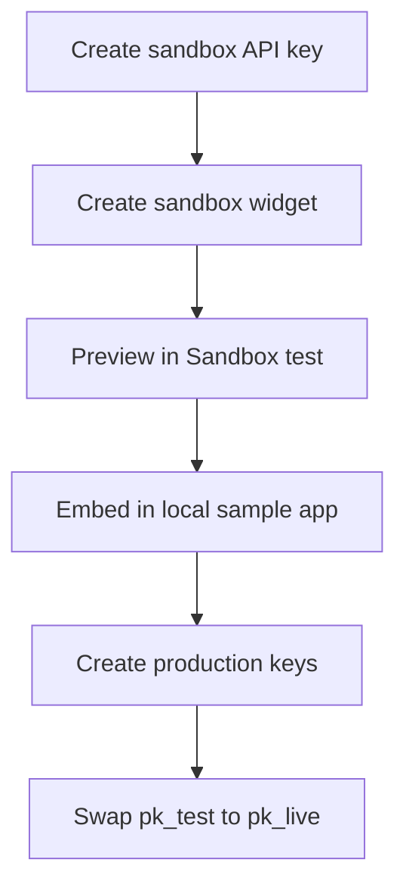

**Sandbox** is a complete parallel environment: separate API keys, separate review widgets, and synthetic testimonials that never touch production ratings.

## Who this is for

Developers embedding the review widget, marketplace partners testing partner APIs, and QA teams validating staging sites.

## What stays separate

| Resource | Sandbox | Production |
| -------- | ------- | ---------- |
| Publishable key | `pk_test_*` | `pk_live_*` |
| Secret key | `sk_test_*` | `sk_live_*` |
| Review widgets | Environment **SANDBOX** | Environment **PRODUCTION** |
| Review data | Synthetic demos | Real ACTIVE reviews |
| API paths | Same (`/api/v1/...`) | Same |

<Check>
  `pk_test_*` works only with sandbox widgets. `pk_live_*` works only with production widgets.
</Check>

## Recommended path



## Dashboard entry points

| Goal | Path |
| ---- | ---- |
| Create `pk_test_*` | **Integrations → API keys** |
| Register a sandbox widget | **Integrations → Review widgets** |
| Live preview + copy snippets | **Integrations → Sandbox test** |
| Marketplace synthetic fixtures | **Integrations → Digital platform** |

## Public API base URL

All environments use:

```
https://api.ethioreview.com/api/v1
```

The key prefix and widget environment decide whether you get synthetic or live data.

## One failure mode

**Using a production widget ID with a sandbox key** — resolve fails with `403` (environment mismatch). Create a dedicated sandbox widget under **Review widgets**.

## Next

[Dashboard Sandbox test →](/sandbox/dashboard-test) · [Sample app →](/sandbox/sample-app)
